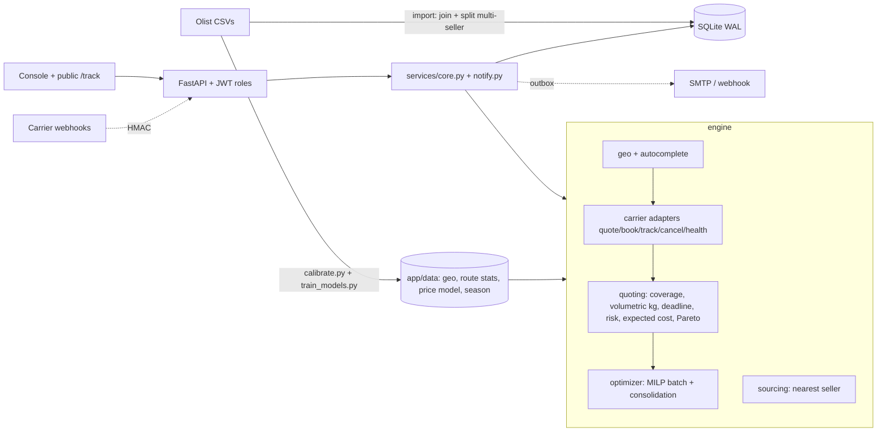

# Olist Logistics Optimizer —  "Control Room"

A logistics optimization platform for Olist that evaluates shipping carriers based on actual delivery routes, selects the nearest fulfillment source, and estimates shipping costs, delivery times (P50/P90), and late-delivery risk.

The platform supports single-order and batch optimization under capacity constraints, with an expected-cost model that combines shipping fees and the estimated financial impact of delays.

Additional features include customer shipment tracking, notifications, barcode-enabled shipping labels, and a bilingual Arabic/English interface with RTL support and dark/light themes.

> Carrier prices/ETAs are **simulated but calibrated on the real Olist 2016-2018 data** — not live carrier prices.

## Quick start
```bash
python -m venv .venv && source .venv/bin/activate        # Windows: .venv\Scripts\activate
pip install -r requirements.txt
cp .env.example .env                                      # set JWT_SECRET / ADMIN_PASSWORD / WEBHOOK_SECRET
python scripts/import_olist.py --data ./olist_data        # unzip archive.zip into ./olist_data first (~10 s, 100k sub-shipments)
uvicorn app.main:app --reload                             # http://127.0.0.1:8000   (API docs: /docs)
```
First start creates `admin`. If `ADMIN_PASSWORD` is empty a random one is printed once in the log. Demo users (`operator/operator123`, `viewer/viewer123`) exist only with `SEED_DEMO_USERS=true`. `APP_ENV=production` refuses to start with weak/missing secrets. Docker: `docker compose up --build`.

## What is new in This Version
| Area | What |
|---|---|
| **Expected cost** | New objective `expected_cost`: minimise `price + P(late) × late_penalty` (default R$ 40, editable per request/UI). Turns "reliability" into money. Works per order and in the batch MILP. |
| **Better price model** | Log-linear model (distance, weight, volume, value, destination) replaces the zone rate card. Hold-out 2018: **R² 0.43 → 0.55**, **MAE R$ 7.22 → 6.01**. Trained offline (`scripts/train_models.py`), coefficients in `app/data/models.json` (no sklearn at runtime). |
| **Peak season** | Nov/Dec ETA factors (P50 ×1.15/×1.28, P90 ×1.24/×1.31) learned from the training year. **Not validated on hold-out** (hold-out is Jan–Aug); switch off with `SEASONALITY=false`. |
| **Customer tracking page** | `/track?code=…` — public, no login, minimal fields (no price/order id/exact address), animated parcel on the map, ETA window, timeline. Endpoint `GET /api/public/track/{code}` is rate-limited. |
| **Label** | Printable shipping label with a Code 128 barcode (marked SIMULATED). |
| **Notifications** | Outbox table for booked / in transit / delivered / canceled; e-mail (SMTP) and generic webhook senders; visible in the UI even when unconfigured. |
| **Network scorecard** | Every carrier quoted on a deterministic sample of real routes: coverage, price, ETA, late risk, win/cheapest/fastest share. |
| **Autocomplete** | Origin/destination typeahead from the local geo tables (city or zip prefix) — no external API. |
| **UI** | Dot-matrix Brazil map (canvas, offline) with animated parcels, delivery-time "race" lanes with deadline marker, slide-over shipment drawer, command palette (Ctrl/Cmd+K), dark/light theme, Arabic RTL, skeleton/empty states, own SVG charts. |
| **Deploy** | `render.yaml` blueprint (unverified), `.env.example`, Docker. |

Everything from v2 is kept (state machine, soft delete + audit, JWT roles, MILP batch with capacity, consolidation, re-routing, HMAC webhook, import with multi-seller split, etc.).

## Backtest (hold-out 2018, `scripts/backtest.py`, page *Backtest*)
Models fitted on orders **before 2018-01-01**, evaluated on 5,000 unseen 2018 sub-shipments; deadline = the date Olist actually promised the customer.

| Policy | Avg cost (BRL) | ETA P50 (d) | Expected late rate |
|---|---|---|---|
| Random carrier | 19.63 | 9.95 | 11.0% |
| Status quo (single carrier) | 19.01 | 10.01 | 10.7% |
| Always cheapest | 15.29 | 10.47 | 12.0% |
| Always fastest | 26.88 | 7.47 | 4.6% |
| **System: cheapest within deadline** | **18.70** | **9.13** | **6.6%** |
| **System: lowest expected cost** (R$ 40/late) | **18.72** | **9.09** | **6.5%** |
| **System: balanced** | 22.08 | 8.31 | 5.1% |

Reading: with the deadline as a constraint the system is ~1.6% cheaper than the status quo, cuts expected lateness by ~4 pp and ETA by ~0.9 day. *Balanced* buys −5.6 pp lateness and −1.7 days for +16% cost. *Always cheapest* is 20% cheaper but makes lateness worse — the trade-off is explicit. The expected-cost policy lands almost where cost-within-deadline does because the P90 deadline filter already removes most risky options; the penalty matters when there is no deadline or when it is large.
Model accuracy on hold-out: ETA P90 coverage **88.4%** (target 90%), P50 coverage 55.7% (slightly conservative). Price bias is **−R$ 3.0**: 2018 freight drifted upward vs the training years, so simulated prices run ~R$ 3 below actual 2018 freight (actual avg R$ 22.49 vs 19.01 simulated for the status quo).
Nearest source (1,000 single-item orders of multi-seller products): different seller chosen in **54%**; distance **553 → 465 km (−16%)**, price R$ 14.39 → 13.63, ETA 9.2 → 8.7 d — under the no-inventory assumption.
> Gains are measured **inside the simulated carrier universe**: they show the optimizer works and how trade-offs behave, not a claim about real carrier contracts.

## Architecture

Scripts: `calibrate.py` (geo/route/ETA tables) → `train_models.py` (price model, season) → `backtest.py` (hold-out evidence) · `build_assets.py` (Brazil dot map) · `import_olist.py` (CLI import).

## Assumptions (read before presenting)
1. No inventory in Olist → candidate sellers = sellers that sold the product before.
2. Carriers are simulated; per-carrier multipliers (price/speed/reliability/coverage) are assumptions that create realistic differences. Olist freight has no carrier id, so per-carrier tariffs cannot be fitted.
3. Origin/destination are zip-prefix centroids (Olist anonymises addresses) → distances approximate.
4. Multi-item parcels: dimensions approximated by a cube of the summed volume.
5. Late risk assumes lognormal transit fitted to (P50, P90). The R$ 40 late penalty is an editable assumption, not measured.
6. Peak-season factors come from one training year and are unvalidated.

## Not included (on purpose)
Google Maps (decision: not needed — the map is built-in and offline); Postgres/Alembic (SQLite WAL + a small versioned-migration runner); Redis/external rate limiter (in-process limiter ⇒ run a single worker); real carrier APIs (adapter template only — e.g. Melhor Envio needs 8-digit postal codes and credentials that Olist's anonymised data does not have); Playwright e2e suite.

## Deploy
Docker image is ready. `render.yaml` is a blueprint for Render (needs a persistent disk because of SQLite → single instance). Set `ADMIN_PASSWORD`, `PUBLIC_BASE_URL`; after the first deploy import the data from the admin UI (*Data import*, upload `archive.zip`, limit 60 MB by default) or mount the CSVs and use *server folder*. Use HTTPS (the platform proxy does it).

## 4-minute demo
1. **Control room** → live arcs of the busiest corridors, KPIs, status mix.
2. **Compare** → São Paulo → Manaus, 2.5 kg, 30×20×15, deadline 35 days: Delta/Gamma excluded (no coverage), the *race* lanes show P50→P90 vs the red deadline line; change objective to **Lowest expected cost** and move the late-penalty; drop the deadline to 20 → no feasible carrier.
3. **Nearest source** → pick a product, Salvador → arcs from each candidate seller, best one highlighted.
4. **Shipments** → *Create* (try typing "campin" for autocomplete, add an e-mail) → drawer opens with the race → **Choose** → Booked → **Customer tracking link** (open it) → **Print label**.
5. **Carriers** → *Simulate outage* on the booked carrier → open the shipment → *Re-route* → alternatives; read the **Network scorecard**; recover the carrier.
6. **Batch optimizer** (300 orders, cost) → like-for-like vs random/cheapest/fastest, unassigned reasons, *Relax* option. **What-if** slider.
7. **Backtest** → price model R² 0.43→0.55, cost-vs-lateness chart, nearest-source numbers. Toggle **Arabic** and **light theme** at the end.
Shortcut: **Ctrl/Cmd+K** jumps anywhere or finds a shipment.

## Tests
```bash
pip install -r requirements-dev.txt && pytest -q
```
`test_engine` (geo, pricing, volumetric, coverage, deadline, MILP capacity, outage, sourcing) · `test_services` (state machine, lifecycle + audit, soft delete, pagination/KPIs, capacity, reroute, webhook, CSV-injection, JWT) · `test_v3` (price model beats the old one on hold-out, peak season, expected cost, autocomplete, notifications outbox, public tracking privacy, scorecard/timeline/flows) · `test_config` · `test_api` (HTTP: auth/roles, 422 validation, lifecycle, HMAC webhook, batch, public tracking, v3 endpoints).
